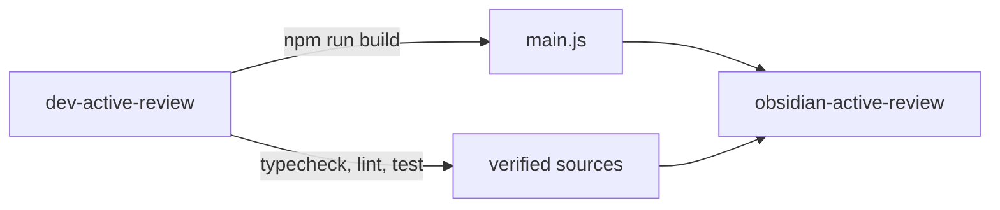
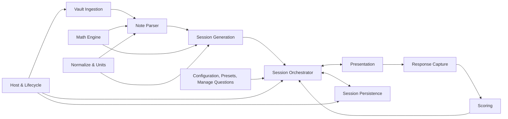

# Active Review Plugin — Workflow & System Architecture

**Baseline checkpoint.** This document describes the plugin code in the release folder `obsidian-active-review/` and the build workspace `dev-active-review/` as a fixed starting point.

| Property | Value |
|---|---|
| Manifest id | `active-review` |
| Display name | Active Review |
| Version | `2.0.0` |
| Minimum Obsidian | `1.13.0` |
| Desktop only | `false` |
| Bundle entry | `src/main.ts` → `main.js` (CommonJS, ES2018) |
| Vault index schema | `3` |
| Session log schema | `1` |

**Document authority.** This file owns architecture, runtime behaviour, data contracts, and operational flows. [[01_Active Review Authoring Rule Book]] owns authoring syntax and author-facing constraints. [[02_Preset Import & Export]] owns manifest schemas, previews, conflict policy, and import/export mechanics in full. If this file and the Rule Book disagree about syntax, the Rule Book wins; if they disagree about system behaviour, this file wins.

**Scope rule.** Everything described here is present in the current code; only present behaviour is described. The plugin is local-only: no network requests, telemetry, or AI calls.

---

## 1. Document map, status, and repository layout

### 1.1 Document map

| Document | Owns | Does not own |
|---|---|---|
| **Active Review Plugin Workflow** (this file) | Architecture, subsystems, runtime flows, configuration, persistence, RNG, build/install, limitations | Authoring syntax; full manifest rules |
| [[01_Active Review Authoring Rule Book]] | Note format, headers, definitions, placeholders, answer formats, grading, distractor rules, workarounds | Module design; session storage; build steps |
| [[02_Preset Import & Export]] | Question and session preset manifest schemas, previews, conflict policy, undo journals | Runtime architecture; session lifecycle |
| `README.md` | Short overview, note-format summary, install snippet, command table | Detailed contracts |

### 1.2 Release folder versus development folder

| Folder | Role | Required contents |
|---|---|---|
| `dev-active-review/` | Build/test workspace | `src/`, `tests/`, `scripts/`, `package.json`, `package-lock.json`, `tsconfig.json`, `esbuild.config.mjs`, ESLint config, `version-bump.mjs`, `.npmrc`, `.gitignore`, `manifest.json`, `versions.json` |
| `obsidian-active-review/` | Release/submission folder | `main.js`, `manifest.json`, `styles.css`, `versions.json`, `src/`, `tests/`, `scripts/`, `README.md`, `LICENSE`, plus the package/build configuration files |

The release folder is not the build root. `package.json`, `tsconfig.json`, `esbuild.config.mjs`, and `tests/` are development tooling: they produce and verify `main.js`, but Obsidian does not need them at runtime. The Linux build in the dev folder also copies source, tests, scripts, and build configuration into the release folder, so a synced copy of the tooling appears there; the authoritative copy remains `dev-active-review/`.



### 1.3 Status and scope

- All six settings pages use the declarative `SettingPage` API (Obsidian 1.13).
- `rounds`/`round_history` are typed and serialized but only partially implemented; see §10.6.
- Snapshot `filter` and `sessionShortcut` are write-only compatibility values; `categoryScope` is still displayed and used by history filtering.

---

## 2. Product model and terminology

### 2.1 What the plugin does

Active Review turns Markdown notes in a configured review folder into one interactive quiz session.

1. The scanner finds every `.md` file under the review folder, excluding the session subfolder.
2. The parser turns each note into a `Question`: variants, answers or an `rv-answer` spec, distractors, definitions, explanation, category, priority, warnings.
3. At start the generator selects and freezes a subset, orders it, draws values from a seed, renders placeholders, builds choices, and writes a pending log.
4. The view renders multiple-choice or typed cards; answers grade on submit.
5. When every item is submitted, the log becomes `completed` and the view offers View session, Open raw note, or New session.
6. Completed sessions can be viewed read-only, reproduced, renamed, archived, unarchived, or deleted.

### 2.2 What it does not do

- No spaced repetition, grading queues, or Anki interoperability.
- No AI generation, network access, telemetry, or remote assets.
- No multi-question files: one quiz note is one question, with optional stem variants.
- Choice count is a session setting (2–6, default 4); below two total choices the card falls back to typed input.
- No live editing of a running session's configuration, pool, or seed.
- No automatic migration of frozen session paths when notes move.
- No “retry wrong” flow. Completion offers View session, Open raw note, New session, and Retry saving on failure.

### 2.3 Terms

| Term | Meaning |
|---|---|
| **Quiz note** | A `.md` file under the review folder with parseable sections |
| **Question** | Parsed unit: variants, answers, distractors, definitions, explanation |
| **Variant** | One `---`-separated block under `## QUESTIONS` |
| **Answer variant** | One `## ANSWERS` block, or one `rv-answer` multi-value variant |
| **Session** | One run through a frozen pool of questions |
| **Session question / item** | A `Question` after draws, choice building, and substitution |
| **Frozen pool** | Ordered question paths selected for a session |
| **Initial order** | Display sequence, stored as indices into the frozen pool |
| **Session log** | The `session-*.md` note recording config, pool, answers, scratch, flags, timers |
| **Seed input** | User-visible integer; `0` means auto-generate at start |
| **Session seed** | 32-bit hash driving all session randomness |
| **Stream** | Independent RNG domain: `trim`, `order`, `draws`, `options`, `variant` |
| **Manage selection** | The subset chosen by Manage Questions |
| **Matched question** | Declared `rv-category` equals the note's folder (case-insensitive) |

### 2.4 Answer formats

| Format | Declared by | Builder | Grading |
|---|---|---|---|
| Numeric answer | Numeric `<<rv:val:…>>` answer block, no quantity slots | `buildNumericQuestion` | Numeric tolerance plus accepted display forms |
| Text answer | No numeric blocks and no quantity slots | `buildTextQuestion` | Normalized text equality |
| Quantity answer | `rv-answer` fence, or automatically from a `valueType: quantity` definition bound in `## ANSWERS` | `buildQuantityQuestion` | Unit-aware comparison |
| Multi-value answer | `rv-answer` with two or more value headers (`answerSpec.kind === 'prose'`, the parser's label for multi-value) | `buildMultiValueQuestion` | Complete variant or values-list match |

`Question.answerFormat` exists only for quantity/multi-value. One binding gives `'quantity'`; multiple give `'prose'`, which the parser uses as its multi-value label. Both carry `answerSpec`.

### 2.5 Five RNG streams

| Stream | Extra seed input | Drives |
|---|---|---|
| `trim` | `''` | Seeded subset when `trim: rand` and `count < total` |
| `order` | `''` | `random` and `priority-random` shuffles |
| `draws` | Question vault path | Every `rand`, `pick`, `exprPick`, quantity/unit/prefix draw |
| `options` | Question vault path | Stem variant, text correct block, choice order, numeric/quantity/multi-value distractor selection |
| `variant` | Question vault path | `rv-answer` answer-variant choice in quantity/multi-value |

Numeric and text builders choose the stem from `options`; only quantity and multi-value use `variant` for the answer variant, so adding that stream does not shift their draws.

---

## 3. Runtime architecture

### 3.1 Layers

```
constants
   ↓
  math          normalize          units
   ↓               ↓                ↓
 parser ───────────┴────────────────┘
   ↓
 session ──→ util
   ↓
 vault (Obsidian file I/O, log schema, indexes)
   ↓
   ui (views, screens, modals, DOM)
   ↓
 main (plugin lifecycle)
```

- `math/` (including its `normalize/` and `units/` subfolders), `parser/`, `session/`, `util/` have no Obsidian imports.
- `math/units/` owns unit parsing/conversion/quantity formatting/grading; `math/normalize/` owns answer-text and expression normalization. They are separate layers inside `math/`, not parser submodules. Both are backend shaping layers: they never participate in authoring syntax, they take the wide constraint the author wrote and the wide input the user typed and reduce each to a canonical form used for grading (and for display).
- `vault/` alone owns quiz/session storage, scanning, serialization, preset transfer, and cache I/O.
- `ui/` renders and orchestrates; it does not re-implement parsing, generation, grading, or log serialization. Cross-screen modules stay at the `ui/` root; feature folders are `screens/`, `history/`, `manage/`, and `presets/`.
- `main.ts` owns lifecycle, settings, scanning, index hydration, and view registration.

### 3.2 System map



### 3.3 Subsystem catalog

| Subsystem | Modules | Owns |
|---|---|---|
| **H Host/lifecycle** | `main.ts`, `settings/SettingsTab.ts` | View/ribbon/command/settings registration; data/index load; maps; validation cache; scanning; `whenReady()`; `activateView()`. A restored tab renders a shell, then copies `settings.sessionDefaults` when ready. `scanAll()` runs on Rescan, review/session folder change, `forceShowWarnings` change, Manage add/delete/move category, Manage import apply and undo, Category Sync, index scope mismatch, and bootstrap; otherwise vault events are incremental. |
| **I Ingestion** | `vault/scanner.ts`, `vault/folders.ts`, `parser/paths.ts` | Filter `reviewDir` prefix (case-sensitive), exclude session subfolder, basename ending `.md`; path sort `localeCompare`; `mtime`+`size` cache; 500 ms event batching; incremental per-file updates. `scanReviewFolders()` includes empty folders, excludes session/dot folders, sorts with plain `.sort()`. |
| **Index** | `vault/indexCodec.ts`, `vault/vaultIndex.ts`, `vault/sessionIndex.ts` | `INDEX_SCHEMA = 3`; gzip via `CompressionStream` with plain JSON fallback; `.tmp`/`.bak` rotation; 2 s debounce; quit save; 250-entry hydration chunks; 25-stale inline reparse. See §13. |
| **P Parser** | `parser/parseNote.ts`, `sections.ts`, `placeholders.ts`, `paths.ts`, `types.ts`, subfolders `answers/`, `definitions/`, `distractors/`, `explanations/`, `properties/`, `questions/` | Frontmatter, H2 sections, blocks, `rv-def`, `rv-answer`, `rv-distract`, placeholder validation, literal markers, answer-format classification, numeric pruning, category, warnings, fatal errors. See §5. |
| **M Math** | `math/tokenizer.ts`, `evaluator.ts`, `symbolic.ts`, `format.ts`, `commands.ts`, `expressionCriterion.ts`, `index.ts`, plus subfolders `math/normalize/` (`answerText.ts`, `expression.ts`) and `math/units/` (`parseInput.ts`, `parseUnit.ts`, `format.ts`, `resolveAnswer.ts`, `registry.ts`, `dimensions.ts`, `prefixes.ts`, `currency.ts`, `types.ts`) | LaTeX-subset evaluation, symbolic `<<rv:expression>>`, structural comparison, numeric formatting, answer-text/expression normalization, unit parsing and quantity grading. `fmt()` is numeric-only (4 decimals, no trailing zeros, `toPrecision(6)` above `1e15`, `-0` → `0`); quantities use `fmtQuantity`/`fmtQuantityValue`. No vault/UI state. |
| **G Generation** | `session/assemble.ts`, `session/build/index.ts`, `build/text.ts`, `build/numeric.ts`, `build/quantity.ts`, `build/multiValue.ts`, `resolve.ts`, `draws.ts`, `distractors/numeric.ts`, `distractors/quantity.ts`, `distractors/multiValue.ts`, `distractors/condition.ts`, `rng.ts`, `order.ts`, `grading/grade.ts`, `grading/text.ts`, `grading/multiValue.ts`, `hydrate.ts`, `timer.ts`, `types.ts`, `index.ts` | Seed/streams, trim/order, draws, substitution, answer extraction, distractors, choice shuffling, frozen rebuild, grading, hydration, timers. See §6. |
| **S Orchestration** | `ui/ReviewView.ts`, `ui/screens/QuizScreen.ts`, `ui/screens/SessionViewScreen.ts`, `vault/sessionRuntime.ts`, `session/config.ts`, `session/start.ts` | Start → quiz → completion → view; config/snapshot; current index/display mode; pending file; single write chain; save; resume/restart/reproduce/archive/unarchive/delete/rename; history; timers, flags, navigator. Pending file exists before the first card; replay never writes. Quiz tabs attach to a shared group instead of owning a runtime directly. `sanitizeSessionConfig` and `openFreshSession`/`generationEntries` are shared by tabs and embeds. |
| **E Embed** | `embed/spec.ts`, `embed/index.ts`, `main.ts`, `styles.css` | `active-review` code block registration, `MarkdownRenderChild` lifecycle, plain fallback inside the review root, minimal start card, embedded controller. Reuses `planSession`, `openFreshSession`, `renderQuizScreen`, `SessionHub`, and the shared rename/leave modals. See `03_Embedded Quiz Blocks`. |
| **T Session sync** | `vault/sessionHub.ts`, `util/adaptiveQueue.ts` | One `SharedSession` per session file (a group); planning runs first, then questions are generated incrementally by an adaptive time-sliced queue; attach/detach reference counting; immediate in-memory broadcasts for pick, submit, flags, and page index; coalesced async broadcasts for drafts/scratch; one timer/stopwatch per group; flush on last detach. Each tab renders its own card DOM through a per-screen adaptive queue. Different session files are independent groups. |
| **R Response** | `ui/QuestionCard.ts`, `ui/MarkdownEditor.ts` | Choice grid, scratch/final editors, submit enablement, flags, feedback, explanations. Textarea + 250 ms preview; one editor across the view; scratch never affects correctness; empty typed answers cannot submit. |
| **C Scoring** | `session/grading/grade.ts`, `session/grading/text.ts`, `session/grading/multiValue.ts`, `math/normalize/answerText.ts`, `math/normalize/expression.ts`, `math/units/parseInput.ts`, `math/units/index.ts` | Choice correctness; `gradeQuantity`; multi-value variant/values matching; `TOLERANCE = 0.001` numeric match; normalized text match; structural math equivalence. See §6.6. |
| **D Persistence** | `vault/sessionLog.ts`, `vault/sessionIndex.ts`, `vault/sessionRuntime.ts`, `vault/sessionHub.ts` | `schema_version: 1` serializer/parser, in-place updates, history lookup, `session_id`, rename/archive/unarchive/delete, `reproduced_into`, session index. Files live at `<reviewDir>/<sessionsSubdir>/session-<id>.md`. All attached tabs for one file share one write chain. See §13. |
| **U Presentation** | `ui/ReviewView.ts`, `ui/screens/StartScreen.ts`, `ui/screens/QuizScreen.ts`, `ui/screens/SessionViewScreen.ts`, `ui/QuestionCard.ts`, `ui/history/SessionHistoryPanel.ts`, `ui/history/SessionHistoryModal.ts`, `ui/history/SessionDetailPanel.ts`, `ui/MarkdownEditor.ts`, widgets/modals, `styles.css` | DOM, sticky headers, toggles, progress, navigator, history, modals, Markdown, responsive CSS. Lazy card Markdown via shared `IntersectionObserver` (300 px); no `innerHTML`; `.rv-*` scope. |
| **F Config/presets** | `constants.ts`, `settings/`, `ui/screens/StartScreen.ts`, `ui/TimerConfigSection.ts`, `vault/manage*.ts`, `vault/sessionPresets.ts`, `vault/sessionPresetTransfer.ts`, `vault/syncCategory.ts`, `ui/presets/PresetManager.ts`, `ui/presets/QuestionPresets.ts`, `ui/presets/SessionPresets.ts`, `main.ts` | `SessionConfig`, `data.json`, folders, six settings pages, session/Manage presets, import/export/undo, Category Sync, warning suppression. Folder changes do not move notes/logs; settings save full objects. |

---

## 4. Configuration surface

### 4.1 `data.json`

| Key | Type | Default | Meaning |
|---|---|---|---|
| `reviewDir` | `string` | `review` | Review root |
| `sessionsSubdir` | `string` | `!rv-sessions` | Session folder under the review root |
| `forceShowWarnings` | `boolean` | `false` | Ignore `<!--ignore-warnings-->` |
| `sessionDefaults` | `SessionConfig` | `DEFAULT_SESSION_CONFIG` | Defaults copied into newly opened views |
| `managePresets` | `ManageQuestionPreset[]` | `[]` | `{ id, name, includedPaths, showOnStart }[]` |
| `sessionPresets` | `SessionPreset[]` | `[]` | `{ id, name, mode, config, showOnStart }[]` |
| `manageImportJournal` | `ManageImportJournal \| null` | `null` | One-step Manage import undo |
| `sessionImportJournal` | `{ presetsBefore: SessionPreset[] } \| null` | `null` | One-step session-preset import undo |
| `lastCustomSelection` | `string[]` | `[]` | Last applied custom selection |

Settings save as a full object via `saveData(this.settings)`. All presets live in `data.json`, never in the vault.

### 4.2 `SessionConfig` defaults

| Field | Type | Default | Meaning |
|---|---|---|---|
| `presentation` | `'all' / 'one'` | `all` | All cards or one at a time |
| `choiceCount` | `number` | `4` | MCQ options including the correct answer (2–6) |
| `count` | `number / 'all'` | `all` | Subset size |
| `trim` | `'seq' / 'rand'` | `seq` | Sequential prefix or seeded subset |
| `order` | `'source' / 'random' / 'priority' / 'priority-random'` | `source` | Display order |
| `seed` | `number` | `0` | `0` = auto at start |
| `submitMode` | `'auto' / 'any' / 'all'` | `any` | Lock-in style |
| `gradeMode` | `'immediate' / 'afterAll'` | `immediate` | Feedback timing |
| `passScore` | `number / 'off'` | `80` | Pass threshold; **on by default** |
| `managePresetId` | `string` | `all` | Manage selection |
| `timerSessionMode` | `'off' / 'on' / 'soft'` | `off` | Session timer |
| `timerSessionSeconds` | `number` | `60` | Duration |
| `timerSessionWarningSeconds` | `number` | `0` | Warning threshold |
| `timerQuestionMode` | `'off' / 'on' / 'soft'` | `off` | Per-question timer |
| `timerQuestionSeconds` | `number` | `60` | Duration |
| `timerQuestionWarningSeconds` | `number` | `0` | Warning threshold |
| `stopwatchSession` | `boolean` | `false` | Session stopwatch |
| `stopwatchQuestion` | `boolean` | `false` | Per-question stopwatch |
| `navigator` | `boolean` | `true` | Navigator grid |
| `allowFlag` | `boolean` | `true` | Flag controls |

The `Default` session-preset chip restores `DEFAULT_SESSION_CONFIG` and switches to Multiple Choice; it does **not** restore the user's saved settings defaults.

### 4.3 Settings pages

| Page | Controls / behaviour |
|---|---|
| **Folders** | Review folder, session folder, Apply; validates/creates folders; does not move notes/logs; rescans |
| **Session Defaults** | Presentation, choices, count, trim, order, seed, submit, grade, pass score, both timers, both stopwatches, navigator, allow flag; writes `settings.sessionDefaults` for later-opened views |
| **Manage Session Presets** | Full manager: rename, duplicate, delete, drag-reorder, export, import, undo |
| **Manage Question Presets** | Full manager: rename, delete, bulk delete, drag-reorder, export, import, undo |
| **Category Sync** | Arrange move, Arrange update; preview, selection, destructive confirmation |
| **Advanced** | Force show all warnings; toggles `forceShowWarnings` and rescans |

The Manage Session Presets and Manage Question Presets rows now support per-preset **Show on start / Hide on start**. Hidden presets stay saved and remain usable by embedded cards and imports.

### 4.4 Copy-on-open and presets

`ReviewView.onOpen()` copies `settings.sessionDefaults` once after `whenReady()`. Settings changes affect newly opened views and restored tabs opened afterwards, not an already-rendered start screen. A manual change to any Session Configuration control except Session Name clears the active preset and marks `Custom`; changing answer mode also clears it.

Selecting a named preset merges `DEFAULT_SESSION_CONFIG` with its `config`, sanitizes, applies its `mode`, converts typed + AutoSubmit to Submit any, and disables per-question timers/stopwatch when Presentation is not One-at-a-time or Submit is All.

### 4.5 Folder behaviour

The review folder input trims slashes, collapses separators, rejects empty and `..`, and rejects an existing file; a missing folder is created. Notices state that existing notes/logs in the previous folder were not moved. The session folder input rejects empty and `.`/`..` segments, creates the folder, and warns when quiz notes currently live under the new path. Both Apply actions and `forceShowWarnings` changes run a full scan.

### 4.6 Embedded quiz blocks

A ` ```active-review ` fence outside the review root renders an embedded session start card, then the quiz. Inside the review root it renders as an ordinary code block, silently. The check uses `ctx.sourcePath`, so question cards, answer blocks, and explanations are covered by the same rule.

The block parser (`embed/spec.ts`) is pure and accepts a YAML-ish `key: value` format with full-line comments, multi-line `message`/`submessage`, wiki links, markdown links, and raw vault paths. Resolution mirrors the tab: `DEFAULT_SESSION_CONFIG` → preset config → block overrides → `sanitizeSessionConfig`; typed + AutoSubmit becomes Submit any. The question pool is the preset pool (or `questionPreset` union), plus `include`, minus `exclude`; `pool: replace` uses includes only. Exclude wins; paths are deduplicated. Missing presets and empty pools block the start; unresolved/unusable links are start-card warnings.

`sessionPreset` is the only required key. Hidden session and question presets are usable. The session name defaults to the host note basename. Sessions are normal pending session notes and appear in history.

Embedding reuses the tab's runtime: `planSession` → `openFreshSession` → `SessionHub`/`SessionRuntime` → `renderQuizScreen`. An in-memory registry keyed by note path + block source keeps one instance while the note is open in any Markdown mode (Live Preview, Reading, Source), even when no code-block renderer is mounted during a mobile mode switch; the replacement render reattaches to the same runtime. Back detaches to a Continue-only start card without creating a new session. Closing the note tab or Obsidian drops the registry entry after a short grace period, so a reopened note starts fresh. See `03_Embedded Quiz Blocks` for the full syntax and override table.

---

## 5. Authoring-to-data contract

### 5.1 Parse pipeline

`parseQuestionNote(path, content, reviewDir)`:

1. Extract frontmatter, H2 sections, block fences, markers, blocks.
2. Reject `rv-exclude: true`.
3. Reject removed placeholder aliases (`<<rv:var:…>>`, `<<rv:eq:…>>`, `<<rv:ev:…>>`, `<<rv:expr:…>>`, `<<rv:exprs:…>>`, `<<rv:expressions:…>>`) and deprecated `rv-var` / `rv-eq` definition fences.
4. Reject misplaced or duplicate `rv-distract` fences.
5. Parse priority, variants, explanations, definitions, answers, distractors, distractor links.
6. Validate placeholder names and expression-call order in unflagged sections.
7. Resolve category from folder + declared value.
8. Assemble `Question`.

Thrown errors become issues and skip the note. Warnings stay on `Question.warnings`. `<!--ignore-warnings-->` records a section in `ignoredWarnings`; `forceShowWarnings` overrides display suppression. `<!--debug-called-definitions-->` records `literalSections` and renders that section's placeholders literally.

### 5.2 `Question`

| Field | Type | Meaning |
|---|---|---|
| `path` / `title` | `string` | Full vault path (identity) / filename without `.md` |
| `variants` | `string[]` | Stem blocks |
| `answerMode` | `'numeric' / 'text'` | Content-derived |
| `answerFormat` | `'quantity' / 'prose'?` | Present only with an `AnswerSpec`; `'prose'` is the parser's multi-value label |
| `answerSpec` | `AnswerSpec?` | Bound slots and variants |
| `answerBlocks` / `numericAnswerBlocks` | `string[]` | Kept answer blocks / numeric-first blocks |
| `distractorBlocks` | `string[]` | Kept distractor blocks |
| `vars` / `links` | `VarDef[]` / `string[][]` | Definitions / `link()` groups (a `-name` member is flipped) |
| `explanation` | `string?` | Raw Markdown |
| `category` / `declaredCategory` | `string[]` | Resolved / frontmatter category |
| `categorySource` | `'folder' / 'frontmatter' / 'none'` | Resolution source |
| `priority` | `number` | Default 100 |
| `answerName` / `answerValNames` | `string` / `string[]` | First bound name / all bound names |
| `distractorLinks` | `DistractorLink[]?` | `{ targets, anchor }` from `rv-distract` |
| `warnings` | `Warning[]` | Non-fatal issues |
| `ignoredWarnings` | `Set<string>` | Suppressed warning sections |
| `literalSections` | `Set<string>` | Sections rendering literally |

### 5.3 `VarDef`

| Field | Meaning |
|---|---|
| `name` | Definition name |
| `kind` | `rand`, `pick`, `stringPick`, `exprPick`, `fixed`, `expr`, `unit`, `prefix`, `quantity`, `quantityPick` |
| `first`, `last`, `step`, `fixed` | Range metadata; fixed/expression uses equal bounds |
| `values` | Pick values (numbers, strings, unit values, quantities) |
| `valueSources` | Per-value display source for string picks |
| `dependencies` | Names referenced by the RHS |
| `max_index` | Optional `rand` cap |
| `expr` | Raw RHS for computed definitions |
| `valueType` | `number`, `string`, `prefix`, `unit`, `quantity` |
| `quantity` | `{ valueExpr, fixedValue?, prefix?, prefixRef?, unit?, unitRef? }` |
| `prefixValues` | Prefix metadata for unit picks |

Quantity definitions use `kind: 'quantity'`; unit/prefix picks use `'unit'`/`'prefix'`.

### 5.4 `AnswerSpec`

An `AnswerSpec` exists whenever any quantity slot exists, including the automatic path where a `valueType: quantity` definition is bound by `<<rv:val:name>>` in `## ANSWERS` without an `rv-answer` fence.

| Field | Meaning |
|---|---|
| `kind` | `'scalar'` for one slot, `'prose'` for multiple (the parser's multi-value label) |
| `slots` | `AnswerSlotSpec[]`, one per bound value |
| `variants` | Parsed answer variants |
| `typedMode` | `values`, `prose`, or `either` |
| `sep` | Values separator, default `,` |
| `distractorStrategy` | `variable` (fixed; no key selects another) |
| `raw` | Original `rv-answer` source |

`AnswerSlotSpec` carries `valueName`, unit system/expression, unit mode, display mode, prefix policy, allowed prefixes, precision (min/max significant figures), notation, `unitOptional`. Automatic slots default to the definition unit, `unitMode: expanded`, `display: atomic`, `prefixPolicy: any`, `allowedPrefixes: auto`, significant figures 3…15, `notation: auto`, `unitOptional: false`.

### 5.5 `SessionQuestion`

| Field | Meaning |
|---|---|
| `q`, `id` | Source `Question`; frozen-pool index (stable key) |
| `text`, `variantIndex` | Resolved stem; selected stem variant |
| `values`, `sources` | Resolved values and display sources |
| `choices`, `correctText` | Built choices (one correct); rendered answer |
| `correctNumbers` | Numeric values, or quantity/multi-value vector |
| `answer`, `multiValue` | `ResolvedQuantityAnswer` / `ResolvedMultiValueAnswer` |
| `acceptedAnswers`, `explanation` | Accepted strings; rendered explanation |
| `given`, `givenNote`, `pickedIndex` | Submitted answer/provenance/choice |
| `isCorrect`, `submitted` | Grade and lock state |
| `scratch`, `finalDraft` | Draft state |
| `missingPath` | Read-only missing-note placeholder marker |
| `timeSpentMs`, `timerRemainingMs`, `timerExpired` | Timer data |
| `buildWarnings` | Per-instance generation warnings |

`ResolvedQuantityAnswer`: `canonical`, `unit`, resolved `policy`, `displayPrefix`, `displayScale`, `text`, `numericValues`. `ResolvedMultiValueAnswer`: `variants`, `correctVariantIndex`, `correctText`, `slots`, `vector`.

### 5.6 Category, priority, exclusion, warnings

- `rv-category` is slash-separated. The note's folder is primary; declared frontmatter is used at the review root. `categorySource` records the winner.
- `declaredCategory` is the raw frontmatter value. Manage compares it with the folder case-insensitively. A mismatch is counted, excluded from Manage selection, and excluded from new sessions.
- `rv-priority` defaults to 100; lower is earlier.
- `rv-exclude: true` returns `null`, so the note is absent from the index.
- Warnings group by `definitions`, `questions`, `answers`, `distractors`, `explanations`, or `general`.

---

## 6. Session generation contract

### 6.1 Seed and streams

```
seedInput   = config.seed === 0 ? random 1…2_000_000_000 : config.seed
selection   = `count=<n|all>|trim=<seq|rand>`
sessionSeed = FNV1a(`${seedInput}|${selection}|${pathsSortedDefault.join('\n')}`)
streamSeed(name, extra) = FNV1a(`${name}|${sessionSeed}|${extra}`)
```

- `pathsSortedDefault` is `[...relativePaths].sort()` — plain UTF-16 ordering, **not** `localeCompare`.
- `order` is excluded from the selection string, so changing display order does not change the subset. `priority` is not in the seed.
- RNG is `mulberry32`; shuffling is Fisher–Yates. `Math.random()` is used only for the auto seed input and preset IDs.
- Scanner path order and priority-tie order still use `localeCompare`.

The five streams are in §2.5. `trim` is used only for a random subset; `order` only for random/priority-random; `draws`/`options`/`variant` are per question.

### 6.2 Trim, freeze, order

`trimQuestions()`:

1. `count === 'all'` or `count >= pool.length` → `pool.slice()`.
2. `trim === 'seq'` → first `count`.
3. `trim === 'rand'` → shuffle with `trim`, take `count` paths, then re-filter the original pool. The frozen pool is therefore always in source (path-sorted scanner) order.

`orderPool()`: `source` unchanged; `random` Fisher–Yates with `order`; `priority` ascending priority then `path.localeCompare`; `priority-random` ascending priority groups, each shuffled with `order`. `initial_order` records frozen indices; `SessionQuestion.id` is the frozen index, so reordering never changes answer keys.

### 6.3 Builder dispatch

`buildQuestion()` in `session/build/index.ts` is the single dispatch: multi-value → `buildMultiValueQuestion`; `answerSpec` → `buildQuantityQuestion`; numeric → `buildNumericQuestion`; otherwise `buildTextQuestion`. `buildSession`, the frozen rebuild, and reproduce all call it.

### 6.4 Builders

- **Numeric answer** (`buildNumericQuestion`): 50 tries for a finite answer; every numeric answer value becomes `correctNumbers`; first numeric block is the choice template; every answer block is normalized into `acceptedAnswers`; author distractors are used only when `## DISTRACTORS` is literal, otherwise `buildNumericDistractors`; stem from `options`; choices shuffled. Failure: `the answer is not a finite number for the generated values`.
- **Quantity answer** (`buildQuantityQuestion`): requires `answerSpec`, uses `slots[0]`; 50 tries; bound value renders as `answer.text` everywhere; answer block chosen with `variant`; warns if it lacks `<<rv:val:<slot>>>`; unit-aware distractors; stem from `options`. Failure: `the answer is not a finite quantity for the generated values`.
- **Multi-value answer** (`buildMultiValueQuestion`): requires `answerSpec` and ≥1 variant; 50 tries; resolves every slot; stem from `options`; complete answer variant from `variant`; distractors change slot values while reusing wording; returns canonical vector, `multiValue`, and every variant text. Failure: `the answer is not a finite quantity set for the generated values`.
- **Text answer** (`buildTextQuestion`): resolves variables if present (50 tries); stem from `options`; correct `## ANSWERS` block from `options`; accepts every block; shuffles distractors and takes up to `choiceCount − 1`; shuffles choices. Failure: `could not resolve variables for this draw — try rescanning`.

### 6.5 Distractors and choice count

Numeric distractors combine author blocks, dependent drawables, perturbation, and range deviations, avoiding the correct/taken values. Quantity distractors are unit/precision-aware. Multi-value distractors change slot values and re-render the chosen wording. Text distractors are shuffled author blocks with no deduplication. Below two choices, the card falls back to typed input in choice mode; validation warns `Insufficient choices — session will fall back to typed mode.`

### 6.6 Grading

| Format | Rule |
|---|---|
| Choice | `choices[picked].correct === true` |
| Quantity | `gradeQuantity`: parse value + unit (normalizing thousands commas and currency labels), check dimension/unit/prefix/precision, then accepted text with structural equivalence |
| Multi-value | Complete variant (`prose`), one value per slot (`values`), or both (`either`) |
| Numeric | `Number(input)` within `0.001` of any `correctNumbers`, then normalized accepted text |
| Text | Normalized input equals any normalized accepted answer |

Grading is silent at submit; `gradeMode` controls only feedback reveal. Scratch never affects correctness. Before any rule in this table runs, both sides pass through the normalization backend: `normaliseAnswerText()` strips `$`/`$$`, `\text{…}`, `\mathrm{…}`, and LaTeX spacing; `normalizePresentation()` preserves case and normalizes superscripts, delimiters, fractions, products, and spacing. Quantity input normalization also collapses thousands commas (`1,000` ≡ `1000`) and, for a currency answer declared with `rv-currency` or `unit("USD")` in `rv-definitions`, rewrites the currency label to its exact ISO code while rejecting labels from other codes. The grader never sees the raw typed string or the raw authored block — it sees the shaped form, which is why a wide authored constraint and a wide typed answer can still match (see [[01_Active Review Authoring Rule Book]] Part V, §17.7). `rv-comma: true` groups the integer digits of displayed answers and placeholders; it does not change grading.

### 6.7 Output and failure

`buildSession()` returns built items plus one `errors[]` entry per skip. The launcher shows `Skipped N question(s): <title>: <message>; …` for 8 s; if nothing builds, launch returns without a quiz. Scan validation uses `{ ...DEFAULT_SESSION_CONFIG, seed: 1 }`, proving generation at seed 1 only.

### 6.8 Incremental generation (streaming)

Live start/continue/restart plans the session first: `planSession()` (fresh) or `planFrozenSession()` (resume/restart) resolves the seed, trim, frozen pool, display order, and parsed-question metadata without building any choices. `buildPlannedQuestion()` then builds one question at a time from the same path-derived RNG streams, so batch order and batch size cannot change the generated items.

Generation is owned by the group's `SharedSession` and driven by `AdaptiveTaskQueue`:

- each animation-frame slice has a ~8 ms target;
- the batch starts at one task and grows while slices finish under budget;
- a slice overrun halves the next batch (minimum one task);
- a single expensive question is never split, but the next slice processes fewer;
- the current/one-at-a-time question and two lookahead questions are moved to the front;
- hidden tabs pause card rendering but not shared generation.

The pending note is written before any question exists, using the full planned `frozen_pool` and `initial_order`. The note body fills in as questions build; `SessionRuntime` flushes partial items normally. A build error is reported once and removed from `initial_order` (same skip policy as the synchronous builder); a missing source note is excluded during planning. Streamed generation is deterministic and equivalent to `buildSession()`; tests compare both paths.

Each tab consumes `item` events through a second adaptive queue that fills its own card slots. All-at-once sessions show lightweight `Preparing question…` slots first; one-at-a-time shows a loading card for the active question and a `loading` navigator state. The timer is paused until generation completes.

---

## 7. Operator workflow I — start screen and setup

### 7.1 Open and bootstrap

1. `Open quiz` or the ribbon (`list-checks`, tooltip `Open Active Review Tab`) opens the quiz. If no Active Review tab exists, a tab is created and focused. If tabs already exist, `Active Review is already open` lists each one (`Tab N — <session|Start screen>`); `Switch` focuses the chosen tab and `Open new tab` creates another instance.
2. `ReviewView.onOpen()` renders `Loading the question index…` without awaiting initialization.
3. `whenReady()` resolves after `data.json` and index/bootstrap are ready; the view copies `settings.sessionDefaults` and renders once.
4. No quiz note is parsed at startup when a valid index exists.
5. Missing, corrupt, or outdated-schema index → one bootstrap scan with `Active Review: building the question index for the first time…`. An index whose scope no longer matches the configured folders is rescanned silently, with no notice.
6. `Rescan notes` is the only operator-triggered full scan from the start screen: `Rescanning notes and sessions…` then `Rescan complete.` Full scans also run automatically from folder/warning-policy changes, Manage category operations, Manage import apply/undo, Category Sync, and index scope mismatch.

### 7.2 Start screen

Header: `Active Review`, `Start New Session`, `Continue Recent Session`. Start is disabled with zero selected; Continue is disabled with no pending session (tooltip `No pending session`) and opens the newest pending by `created`.

Body: `N of M questions selected.`; optional `N question(s) need Category Sync and are excluded.`; **Session List** with `Full history (N)` and `Rescan notes`; collapsible `Recent`/`Archived` list (four rows then `Show all (N)`); **Skipped Note** and **Warning Note** panels; **Session Configuration** with `Manage Session Presets`; preset row; settings card.

### 7.3 Alert panels and copy

Both panels are collapsibles. Paths open in a new tab. Each header has an icon-only copy button using Obsidian's code-block icon. It writes a Markdown block to the clipboard: count header, one `[[wiki-linked]]` bullet per note, one nested bullet per message. The button cancels the click, so copying never collapses the panel.

### 7.4 Session Configuration controls

| Control | Values | Behaviour |
|---|---|---|
| `Session Name (optional)` | free text, placeholder `Optional name` | Optional; written to the log; does not clear the preset |
| `Question Presets` | `All questions`, `Last custom`, named | `Manage questions` opens the modal |
| `Answer Mode` | Multiple Choice / Typed Answer | Fixed for the live session |
| `No. of Choices` | 2…6 | Multiple Choice only; default 4; saved in session presets |
| `Question Presentation Format` | All at once / One at a time | Fixed for the live session |
| `Order of Questions` | Source / Random / Priority / Priority shuffle | Applies to the subset |
| `No of Questions` | 1…total | Slider + number; equal to total stores `all`; reveals Trim only while below total |
| `Trim method` | Sequential / Random | First N or seeded subset |
| `Submit` | AutoSubmit / Submit any / Submit all | AutoSubmit disabled for typed |
| `Grade` | Immediate / After all | Feedback timing |
| `Pass score` | Off / On + 0…100 | Default On at 80 |
| `Timer` | Session + Per Question: OFF/ON/SOFT, duration, `Warn at` | Per-question only One-at-a-time and Submit ≠ All |
| `Stopwatch` | Session + Per Question | Same availability as per-question timer |
| `Seed` | integer ≥ 0 | `0` auto-generates at start |

Enabling a session timer with a per-question timer defaults duration to `presentedCount × timerQuestionSeconds`; otherwise 60 s. A shorter session timer shows `Session timer is shorter than the total per-question timer allowance.` Invalid timer text shows `Use S, SS, M:SS, MM:SS, H:MM:SS, or HH:MM:SS.` Any change except Session Name marks Custom.

### 7.5 Session preset row

- `Default` sets `DEFAULT_SESSION_CONFIG`, mode `choice`, sentinel `__default`.
- `Custom` clears the active preset without changing configuration.
- Named presets follow; five chips before expanding.
- `+ Save as new` saves `{ id, name, mode, config, showOnStart: true }`.
- `Update existing…` replaces the chosen preset's mode/config.

Save rejects empty and case-insensitive duplicate names with `A session preset with that name already exists.` Default suggestions are `Session preset 1`, `Session preset 2`, ….

### 7.6 Start a new session

1. Resolve the current Manage selection from matched questions.
2. Zero selected: `No matched questions are selected. Open Manage questions or fix category sync first.`
3. If pending sessions exist, `Pending session exists` offers `Cancel`, `Start new`, and `Archive and start new`. The middle action launches without touching any pending file. The destructive action archives only pending sessions that are not currently attached to another tab; attached sessions are reported as left untouched (pending → abandoned). Failures are reported, then the new session launches.
4. `planSession()` with sanitized config: `seed = 0` → random 1…2,000,000,000; derive session seed; trim/freeze/order. No choices are resolved yet.
5. Planning errors show one Notice; if nothing is planned, stop.
6. Effective config (resolved seed input) becomes `saveConfig`.
7. Create `SessionLogState` with `status: pending`, timestamp `session_id`, snapshot, full planned pool/order, `rounds: 1`, one `initial` round, and a timer built from the planned frozen ids (paused).
8. Write the pending file with no generated items before any card renders.
9. Register the runtime in the session hub, start adaptive generation, attach this view as the first member of the group, and render the quiz shell with preparing slots/cards.

Pending-write failure: `Could not write pending session file: <message>` and return to start. `qs_snapshot.seed` is the effective seed input; `session_seed` is the derived hash; `session_seed_default` is that hash at creation.

---

## 8. Operator workflow II — live quiz

### 8.1 Header and status

Back, `Submit answers` (Submit all only), `Rename session`, timer/stopwatch readouts, status/progress, and—one-at-a-time—Previous/Next plus the Navigator toggle when configured.

Status: `Ready N/total` while Submit all waits; `Submitted N/total` otherwise; ` · Score P%` when pass score is on and enough cards are graded; ` · Seed <n>` only when order ≠ `source` or trim = `rand`; ` · Flags N` when flags are allowed. The progress bar tracks ready cards in Submit-all mode, submitted otherwise. The Submit-all button enables when every card has an answer and hides after submission.

### 8.2 Cards

Number, title, category breadcrumb, flag control, per-question timer/stopwatch, stem, Scratch, answer interface, Submit, feedback, explanation.

- Choice grid uses A, B, C, …; clicking the selected choice again deselects.
- Typed input is a click-to-edit textarea with preview. Numeric-only cards use a decimal keyboard; quantity/multi-value use text for units/separators.
- Empty typed answers cannot submit.
- Correct: `Correct.` Incorrect: `Incorrect. Correct answer: <answer>`; numeric choices add `That choice assumed: <note>`.
- Explanation opens automatically when incorrect.

### 8.3 Submit and grade matrix

| Submit mode | Choice card | Typed card | Global action |
|---|---|---|---|
| AutoSubmit | Clicking a choice submits immediately | Not offered for typed | — |
| Submit any | Pick, press `Submit answer` | Type, press `Submit answer` | — |
| Submit all | Pick; no per-card submit | Type; no per-card submit | `Submit answers` enables when every card has an answer |

| Grade mode | Feedback |
|---|---|
| Immediate | Reveal on submit: correct/incorrect, answer, provenance, explanation |
| After all | Unrevealed until every card is submitted, then all reveal and completion runs |

AutoSubmit applies only when the card has choices. A card that fell back to typed in a choice session uses a per-card Submit, except in Submit-all mode.

### 8.4 Flags and navigator

Flags exist only when `allowFlag` is true. Toggling updates the set, sorts it numerically, removes duplicates/non-finite values, and flushes. In one-at-a-time mode with `navigator: true`, an aside grid renders one cell per question with states `unanswered`, `in-progress`, `submitted`, `correct`, `wrong`; flagged cells show `!`. The Navigator toggle is visible only when the config enables it; shown/hidden is a per-view field (`navigatorShown`), initialised from config and not persisted. No navigator in All-at-once mode. Within a session group, flags and the current one-at-a-time page are shared, so every attached tab shows the same navigator state and page.

### 8.5 Timers and stopwatches

Session `ON` forces submission at zero; `SOFT` continues below zero with warning styling. Per-question timers exist only in One-at-a-time with Submit ≠ All; `ON` forces that question to submit/expire, `SOFT` continues. Per-question timers/stopwatches track only the active card. Hard expiry submits a picked choice or draft and grades it; an unanswered card submits incorrect with empty answer and `timerExpired`. Session expiry iterates unsubmitted cards, submits those with answers, expires those without, then completes if all are submitted. Timers pause when hidden and resume when visible; completion stops all timepieces. `timer_state` persists with the session and each answer entry. The clock is owned once per session group (`SharedSession`); attached tabs render the same countdown and stopwatch, and expiry is applied once. Streaming sessions keep the clock paused until every planned question is prepared, so generation time is not charged to the user.

Time input accepts `S`, `SS`, `M:SS`, `MM:SS`, `H:MM:SS`, `HH:MM:SS`. Bare seconds allow 1–6 digits; M:SS minutes 00–99; hours cap 99; minutes/seconds < 60. `MAX_TIMER_SECONDS = 99:59:59`. Display uses tenths under 10 s, `M:SS` under an hour, `H:MM:SS` above; countdowns can show `-`, stopwatches cannot.

### 8.6 Leaving

Back flushes and returns to start. If at least one question is answered and the session is unsaved, an overlay asks `Leave this session?`, reports `N questions answered.`, and says the session stays pending and can be continued from Session history. `Stay` closes; `Leave` flushes and renders start. Closing the view also flushes a pending session. Other tabs attached to the same session continue; the last tab to leave flushes and drops the group.

### 8.7 Multiple tab instances and session groups

A **group** is one session file plus every Active Review tab currently attached to it. Groups are independent; start screens and the read-only session view are always per-tab.

| Surface | Same group (same session file) | Different groups / start / view |
|---|---|---|
| Highlighted choice before submit | shared immediately; persisted | independent |
| Typed final answer | shared; text broadcasts coalesced (~80 ms); persisted on blur/nav | independent |
| Scratch note | shared; coalesced; persisted on blur/nav | independent |
| Submit, grade, score, feedback | shared immediately | independent |
| Flags | shared immediately | independent |
| Timer, stopwatch, per-question time | one clock per group | independent |
| Current page (one-at-a-time) | shared both ways | independent |
| Completion and saved file | one idempotent save; both tabs show completion | independent |

Attaching a tab to an already-playing file reuses the live items, timer, page, and write chain; it does not re-read or rebuild the session. Generation is shared by the group, while each tab renders its own card DOM through an adaptive queue; a hidden tab pauses rendering and catches up when shown. Changes originating in a tab are applied locally and broadcast to the other tabs; the origin does not receive its own echo. Last write wins for simultaneous edits of the same field. A session attached in another tab cannot be deleted, restarted, reproduced, renamed, unarchived, or opened in read-only view from a different tab; those actions show `This session is open in another tab. Close it there before changing it here.` (or `This session is running in this tab. Close it before changing it here.` when the group has no other viewer). Archiving is the exception: from another tab it asks `Archive running session?`, freezes the shared runtime, writes the archive, then notifies the attached tab, which shows `Session archived` with `"<name>" was archived in another tab. This tab will return to the start screen.` and returns to its start screen.

The MCQ highlighted choice is persistent on its own: an unsubmitted `picked` entry is written to the log and restored by `hydrateSessionItems()`, so navigating away, leaving, and continuing keeps the highlight.

---

## 9. Completion, save, and failure handling

Completion triggers when every item is `submitted === true`; timepieces stop, Grade = After all reveals all, and the panel renders:

1. `Session complete: <correct> / <total>`.
2. With pass score: `Passed`/`Failed` plus `Score X/Y (P%) · Pass N%`.
3. `saveSession()` marks completed and writes the same file.
4. Success: `Saved to <path>` plus `View session`, `Open raw note`, `New session`.
5. Failure: `Could not save the session note: <message>` plus `Retry saving`.

No Retry wrong action exists.

`SessionRuntime.save(mode)` returns the saved file if already saved, returns the in-flight promise if saving, returns the existing file without completing when the log is no longer `pending` (another tab archived it), snapshots answers/scratch/timers, creates a completed log with `completed_at` and current mode, and enqueues one write. On failure it restores previous status, `completed_at`, and mode, clears the save promise, and rethrows. All writes serialize through `SessionRuntime.writeChain`; a failed write does not poison later writes.

| Failure | User-visible behaviour |
|---|---|
| Pending file creation | Notice `Could not write pending session file: …`; no quiz |
| Pending flush (blur/nav/back/hide/flag) | `console.warn('[rv] flush failed: …')` only |
| Completion save | Notice `Could not save the session note: …`; `Retry saving` |
| Restart write | Notice `Could not restart the session: …` |
| Reproduce write | Notice `Could not write new session file: …` |
| Reproduce link update | Notice `Could not update original session link: …`; new session still opens |
| Rename/archive/unarchive/delete | Notice naming the action and message |
| Session preset undo | Notice `Undo failed: …` |
| Manage import undo | Notice `Undo incomplete: …` or `Undo failed: …` |

The session note body contains title, status, created/completed, mode, submit, grade, pass score, Manage questions, timer/stopwatch settings and remaining values, seed, reproduction links, progress counts, score/pass-fail when completed, and one `## Questions` entry per displayed question: pool path, quoted stem, chosen/given answer, result, scratch, timer/stopwatch values, and timer-expired marker.

---

## 10. Lifecycle and history

### 10.1 Status transitions

| From | Action | To | Notes |
|---|---|---|---|
| `pending` | Completion save | `completed` | `completed_at` set |
| `pending` | Archive / start-new archive | `abandoned` | `archived_from: pending` |
| `completed` | Archive | `archived` | `archived_from: completed` |
| `abandoned` | Unarchive | `pending` | `archived_from` cleared |
| `archived` | Unarchive | `completed` | `archived_from` cleared |
| `abandoned` + `archived_from: completed` on read | Legacy normalization | reads `archived` | No rewrite |

Labels: `Pending`, `Completed`, `Abandoned`, `Archived`.

### 10.2 Session list

Sessions come from `session-<id>.md`. Sort: pending, completed, abandoned, archived; newest first within status. Rows show status, `session_id - name` (or id), submitted/total, and flag count. The row and detail totals use `frozen_pool.length`, while the log body's own progress line counts the items actually presented (falling back to `frozen_pool.length` only when nothing was presented), so a session that reproduced with missing notes can show two different denominators.

### 10.3 Detail actions

| Action | Availability | Behaviour |
|---|---|---|
| View session | Always, unless the file is attached to a tab | Read-only rebuild from frozen state |
| Continue | Pending | Resume answers, scratch, timers, flags; joins the live group when the file is already attached |
| Restart | Pending, not attached | Confirm; clear answers/flags/scratch and reopen |
| Reproduce | Non-pending, not attached | New pending session from the frozen pool |
| Rename | Always, not attached | Rewrites `session_name` only |
| Archive | Not abandoned/archived | Pending → abandoned; completed → archived; an attached group asks for confirmation first |
| Unarchive | Abandoned/archived, not attached | Restore pending or completed |
| Delete | Always, not attached | Move file to vault trash |

While the file is attached to a tab, every action except Continue is refused with `This session is open in another tab. Close it there before changing it here.`; when the attached group has no other viewer the notice is `This session is running in this tab. Close it before changing it here.` Archive is the sole exception, and only when another tab holds the group: it confirms, freezes the shared runtime, and notifies the attached tabs.

The standalone modal also has `Close`.

### 10.4 View

View rebuilds from frozen pool/order/seed with `includeMissing: true`. Missing notes become `Missing note`, `This note is no longer in the vault.`, plus path. The notice shown on entry still reports the count as `N questions missing from the vault — skipped.` even though the placeholder cards are rendered. Answers/scratch hydrate without timers; cards are read-only; flags are static badges. Display mode starts from `qs_snapshot.presentation` and can be toggled All/One for the view only. Back returns to start; view never writes.

### 10.5 Continue

Continue (also `Continue Recent Session`) plans the frozen state without placeholders; missing notes are skipped and reported. It streams frozen questions into the shared session, hydrating each item's answers, scratch, and timers as it is built, restores `configFromSnapshot(qs_snapshot)` and the mode, and opens at index 0. If the same session file is already attached in another tab, the new tab joins the live group instead of rebuilding: it reuses the current page, in-memory answers/scratch, timer, and write chain.

### 10.6 Restart

Pending-only. Rebuilds frozen items, reuses log identity, pool, seed, order, and mode, clears `answers`, `flags`, `scratch`, `completed_at`, creates a fresh timer runtime, writes immediately, and opens at index 0. Restart does **not** append `round_history` or increment `rounds`; the type allows `restart`/`reset` actions, but none are written. Restart is refused while the file is attached to a tab (§10.3).

### 10.7 Reproduce

Non-pending only. The modal shows pool size and allows name, presentation, Submit, Navigator, Allow flag, Grade, Pass score, Order, Seed, timers/swatches, and — for choice sessions — `No. of Choices`. Count/trim are frozen.

1. Starts from `configFromSnapshot(qs_snapshot)` with `count: all`, `trim: seq`.
2. `seedChanged` compares with `qs_snapshot.seed`; `orderChanged` with `qs_snapshot.order`.
3. Unchanged seed reuses `session_seed`. Changed seed derives from the new input, the **full original frozen pool's** relative paths, `count: all`, `trim: seq`. A new seed of `0` is hashed literally; reproduce does not auto-generate.
4. If neither changed, reuse `initial_order` filtered to available questions.
5. Otherwise reorder available frozen questions with the new order stream.
6. Rebuild each item with the new seed's draw/option/variant streams.
7. New log: `source_session = original.session_id`; `session_seed_default = original.session_seed`; one `reproduce` round at index 1; empty answers/scratch/flags; original mode; `frozen_pool` copied from the original including missing paths.
8. Write the new pending file.
9. Append the new id to `reproduced_into` (idempotent).
10. Render the new quiz.

No available frozen question: `None of the frozen pool questions are available in the vault.` Reproduce is refused while the original file is attached to a tab (§10.3); the new session registers its own group.

### 10.8 Rename, archive, unarchive, delete, links

Rename rewrites only `session_name:`; empty is allowed and displays the id. Archive reads current status and writes target plus `archived_from`; it does not move the file. Unarchive restores `completed` only when `archived_from` is `completed`, otherwise `pending`. Delete uses `app.fileManager.trashFile`, so the vault trash policy applies. `reproduced_into` is append-only and idempotent. All of these are refused while the session is attached to a tab, except archive, which confirms first and then notifies the attached tabs (see §10.3).

### 10.9 Full history modal

`Full history (N)` provides search over id, name, Manage preset name, and categories; status chips All/Completed/Abandoned/Archived/Pending; flags Any/Flagged/No flags; inclusive date range on `created`; category filter from `categoryScope`, else first frozen-pool path segment; a filtered list with date, label, submitted/total, status, flag count; a detail pane using the same session detail panel; `N of M sessions`, `Clear filters`, and `No sessions match these filters.` View/Continue/Restart/Reproduce close and navigate; Rename/Archive/Unarchive/Delete refresh in place.

---

## 11. Manage Questions and Category Sync

### 11.1 Matching and modal

A question is manageable only when `q.declaredCategory` equals its folder under the review root, case-insensitively. A mismatch is counted, excluded from the tree/selection, and excluded from new sessions.

The modal lists only matched questions in a real tree including empty folders. It supports folder/question checkboxes with tri-state folders; `All questions`, `Last custom`, named presets; `+ Save as new preset`, `Update existing…`; `Add subcategory`, `Delete category`; drag-and-drop moving of questions onto categories; `Manage question presets` (opens `QuestionPresetsModal`); `Apply`, `Cancel`.

Clicking a category row selects it for `Add subcategory` / `Delete category` and toggles its expanded state in the same action; the category checkbox only toggles inclusion. The caret is an indicator, not a separate control.

Applying dirty custom selection sets preset id `last-custom` and saves `lastCustomSelection` when custom state was touched. Save-as-new uses current paths and calls `saveManagePresets` without a duplicate-name check; default suggestion is `Custom <n>`. The preset manager's rename path does reject duplicates.

### 11.2 Folder operations

- **Add subcategory** rejects empty, `/`, `.`, `..`, and dot-prefixed names; resolves casing; rejects existing folders case-insensitively; creates; rescans.
- **Delete category** refuses the review root; lifts files one level, merges child folders, suffixes collisions, deletes the emptied folder, and aligns `rv-category` unless `rv-exclude: true`; remaps presets and last custom.
- **Move question** is a drag from the question row onto a category row (mouse: drag past ~5 px; touch: long-press, then drag). Only question rows are draggable and only category rows accept a drop; there is no separate move dialog. Holding shows a floating copy of the row, the hovered category highlights as the drop target, and the source stays dimmed until release. Dropping on the row's own category does nothing; dropping on a category expands it and briefly highlights the moved row. The move resolves casing, creates the target, moves, rewrites/removes `rv-category`, remaps presets/last custom, rescans. Frontmatter failure shows `Moved <path> but could not update rv-category.`

Frozen sessions store paths, so moves can break old sessions. Session logs are not rewritten; missing paths are skipped or shown as placeholders.

### 11.3 Name and file collisions

| Collision | Suffix |
|---|---|
| Manage import, duplicate preset name | `Name (2)`, `Name (3)`, … |
| Vault file target exists | `name-2.md`, `name-3.md`, … |
| Session log file exists | `session-<id>-2.md`, … |
| Session preset import duplicate | `Name 2`, `Name 3`, … |
| Session preset duplicate action | `Name copy`, then `Name copy 2` |

Manage save does not reject duplicate names. Session preset save/rename/duplicate do reject or avoid duplicates.

### 11.4 Category Sync

Two irreversible Settings operations. Each first opens `CategorySyncModal`, a selectable per-note preview tree, then a destructive confirmation that lists the selected entries (`<from> → <to>`, or `<path> → rv-category: <category>`), showing the first five and then `… and N more`.

1. **Arrange move** plans every note whose declared category differs from its folder. Target is the declared category with existing casing resolved; root moves to the review root; collisions get `-2`, `-3`, …; presets and `lastCustomSelection` remap. Notice `Moved N notes.` or a mixed count.
2. **Arrange update** rewrites `rv-category` from the current folder; a root note loses `rv-category`. Notice `Updated N notes.` or a mixed count.

Empty plans show `No notes need moving.` or `No notes need category updates.` Neither can be undone from the plugin. The preview lists only mismatched notes; selecting none disables Continue.

---

## 12. Presets, import/export, and undo

Full manifest schemas, preview statuses, resolution rules, and limits live in [[02_Preset Import & Export]]. This chapter records entry points and effects.

### 12.1 Entry points

| Surface | Action | Opens |
|---|---|---|
| Start screen, Question Presets row | `Manage questions` | `ManageQuestionsModal` |
| Manage Questions toolbar | `Manage question presets` | `QuestionPresetsModal` |
| Start screen, Session Configuration header | `Manage Session Presets` | `SessionPresetsModal` |
| Settings → Manage Question Presets | Page body | `QuestionPresetManager` inline |
| Settings → Manage Session Presets | Page body | `SessionPresetManager` inline |

The only Advanced surface is the one-toggle page. The only command is `open` (`Open quiz`); the ribbon icon is `list-checks` with the tooltip `Open Active Review Tab`. Preset export/import lives in the dedicated preset managers, not inside Manage Questions.

### 12.2 `SessionPreset` and save rules

```ts
interface SessionPreset {
    id: string;
    name: string;
    mode: 'choice' | 'typed';
    config: SessionConfig;
    showOnStart: boolean;
}
```

Presets live in `data.json`. Start-screen save rejects empty and case-insensitive duplicate names, sanitizes, converts typed + AutoSubmit to Submit any, assigns an id with `showOnStart: true`, activates the preset, and triggers `active-review:session-presets-changed`. Update replaces the selected preset's mode/config. The manager also supports rename, duplicate, delete, bulk delete, hide/show-on-start, drag-reorder, export, and import.

### 12.3 Question preset manager

Lists `{ id, name, includedPaths, showOnStart }` with file counts. Supports rename, delete, bulk delete, hide/show-on-start, drag-reorder, export, import, and `Undo last import`. Rename rejects empty/duplicate names. Export can include empty folders. Import supports `Add new`, `Update by name`, and `Move files only`, with dry-run preview.

### 12.4 Export, import, one-step undo

- **Question presets:** export writes `active-review/manage-presets` with folders, file entries, presets. Import previews `move`, `noop`, `missing`, `ambiguous`, `conflict`, `invalid`; modes add/update/structure. A successful apply writes `manageImportJournal` with moves, created folders, preset arrays, and last-custom arrays. `Undo last import` preflights reverse moves and refuses if a source/target is missing or occupied.
- **Session presets:** export writes `active-review/session-presets` version 1, 1 MB / 200 presets maximum. It stores name, mode, referenced Manage preset **name**, `showOnStart`, and config without `managePresetId`. Import resolves `All questions`, `Last custom`, or a case-insensitive Manage preset name; unresolved rows skip. A successful apply writes `sessionImportJournal: { presetsBefore }`; `Undo last import` restores that entire list.

Both undo controls disable without a journal; a new import replaces it.

---

## 13. Persistence and cache

### 13.1 `SessionLogState` (`schema_version: 1`)

| Group | Fields |
|---|---|
| Schema | `schema_version` |
| Identity | `session_id`, `session_name`, `status`, `archived_from`, `created`, `completed_at`, `mode` |
| Graph | `source_session`, `reproduced_into` |
| Seed | `session_seed`, `session_seed_default` |
| Rounds | `rounds`, `round_history` |
| Config | `qs_snapshot` |
| Pool | `frozen_pool`, `initial_order` |
| State | `answers`, `flags`, `scratch` |
| Runtime | `timer_state` |

`RoundEntry`: `{ index, action: initial|restart|reset|reproduce, started, ended }`. `SessionAnswerEntry`: `{ picked?, given?, typed?, isCorrect?, submitted?, firstCorrect?, timeSpentMs?, timerRemainingMs?, timerExpired? }`.

### 13.2 Canonical shape

```yaml
---
rv-session: true
schema_version: 1
session_id: 2026-01-15-143022
session_name: ""
status: pending
archived_from: null
created: 2026-01-15T14:30:22.000Z
completed_at: null
mode: choice
source_session: null
reproduced_into: []
session_seed: 3021456789
session_seed_default: 3021456789
rounds: 1
round_history:
  - index: 1
    action: initial
    started: 2026-01-15T14:30:22.000Z
    ended: null
qs_snapshot:
  presentation: all
  choices: 4
  count: all
  trim: seq
  order: source
  seed: 987654321
  show: submitAny
  grade: immediate
  passScore: 80
  managePresetId: "all"
  managePresetName: "All questions"
  # ...remaining snapshot fields: manageIncludedPaths, categoryScope, filter,
  # sessionShortcut, timer modes/durations/warnings, stopwatches, navigator,
  # allowFlag
frozen_pool:
  - review/physics/rv-a.md
  - review/physics/rv-b.md
initial_order: [1, 0]
answers:
  "0": { picked: 2, given: null, typed: false, submitted: true, isCorrect: true }
  "1": { picked: null, given: "42 J", typed: true, submitted: true, isCorrect: false }
flags: [1]
scratch:
  "0": "working notes"
timer_state: "{\"sessionRemainingMs\":0,\"sessionElapsedMs\":0,\"sessionExpired\":false,\"questionRemainingMs\":{},\"questionElapsedMs\":{},\"questionExpired\":{},\"activeQuestionId\":null,\"running\":false,\"updatedAt\":\"2026-01-15T14:30:22.000Z\"}"
---

# Session 2026-01-15-143022

**Status:** pending
...
```

`qs_snapshot.show` maps to `SubmitMode`: `immediate` → `auto`, `submitAll` → `all`, `submitAny` → `any`. Older logs with no `choices` field read as 4.

### 13.3 Read policy

- `rv-session: true` and a non-null `session_id` are required.
- Every field is optional on read and receives a default; unknown fields ignored.
- Missing `schema_version` = 1; missing `firstCorrect` falls back to `isCorrect`.
- Missing `round_history` becomes one `initial` round.
- Missing `grade` on a legacy log normalizes `show: immediate` to Submit any.
- Answers without `submitted` but with `isCorrect` are submitted.
- Legacy `abandoned` + `archived_from: completed` reads as `archived`.
- `timer_state` is `null` when absent/unparseable; new logs always write an object.
- Malformed logs are skipped from history.

### 13.4 Writes and indexes

Build a plan/seed → create pending log → write pending file with the planned order and no built items → render the quiz shell → stream questions into the shared items while flushing on submit, blur, navigation, back, tab hide/close, flags, rename → on completion mark `completed` and update in place → on failure keep the pending file and expose retry. `flush()` returns early for non-pending/completing sessions and swallows errors with `console.warn`; `writeNow()` propagates; `save()` is idempotent. All writes serialize through one `SessionRuntime.writeChain` per session file; tabs attached to the same file share that runtime, while tabs on different files have separate chains. In-memory sync broadcasts never wait for disk; draft/scratch broadcasts are coalesced and session writes remain coalesced (no per-keystroke disk writes). While streaming, the note's progress denominator uses the planned `initial_order` so it is stable before all questions exist.

The in-memory `SessionIndex` stores `{ mtime, size, log }` per session path; `list()` sorts by status then newest `created`; `pending()` drives the start guard; `rebuild()` runs only from a full scan and reparses changed stats. The start screen reads the hydrated index without scanning.

`<plugin dir>/cache/index.json.gz` is a cache, not a backup.

| Field | Meaning |
|---|---|
| `schema` | `3`; mismatch forces a bootstrap scan |
| `pluginVersion` | Version that wrote the cache (diagnostics only) |
| `scope` | `{ reviewDir, sessionsSubdir }`; mismatch forces a bootstrap scan |
| `builtAt` | Last write timestamp |
| `questions[path]` | `{ mtime, size, q, issue, verdict }` |
| `sessions[path]` | `{ mtime, size, log }` |

`verdict` stores `{ error, warnings, choiceCount }`, so startup rebuilds issues and warnings without `buildSession`. Load tries live, `.bak`, `.tmp`. See §3 for atomic write and hydration details.

### 13.5 Locations

| Data | Path |
|---|---|
| Settings/presets | `<plugin dir>/data.json` |
| Cache | `<plugin dir>/cache/index.json.gz` (± `.bak`, `.tmp`) |
| Quiz notes | `<reviewDir>/…/*.md` (excluding the session subfolder) |
| Session logs | `<reviewDir>/<sessionsSubdir>/session-<id>.md` |

---

## 14. Validation, error policy, performance

### 14.1 Validation

A full scan parses every quiz note, then validates each question with `buildSession([q], { ...DEFAULT_SESSION_CONFIG, seed: 1 })`. The verdict records first error, build warnings, and choice count. A build error becomes an issue and removes the question; choice count below two adds the insufficient-choices warning. Warnings filter by `ignoredWarnings` unless `forceShowWarnings` and deduplicate by message. Verdicts cache by `Question` identity and persist in the index.

### 14.2 Error policy

| Condition | Policy |
|---|---|
| Parse/placeholder/definition/answer-spec failure | Skip file; one issue |
| Removed placeholder alias, deprecated `rv-var`/`rv-eq` fence, or `rv-def:` block | Fatal migration error; the note is skipped |
| Definition failure during draw | Retry 50, then skip with notice |
| Distractor shortfall | Warning; fewer choices or typed fallback |
| Missing question on resume/restart/reproduce | Skip and report |
| Missing question in view | Placeholder card |
| Session write failure | Notice or console warning per §9 |
| Malformed session log | Skip in history |
| Session filename collision | `-2`, `-3`, … |
| Invalid timer input | Notice; restore previous value |
| Category mismatch | Count; exclude from Manage/new sessions |
| Import row unresolved/conflicting | Preview status; skipped by default |
| Undo preflight failure | Refuse and report |

### 14.3 Performance and privacy

Startup reads one gzip index; no note is parsed. Full scans run on Rescan, review/session folder change, `forceShowWarnings` change, Manage category add/delete/move, Manage import apply and undo, Category Sync, index scope mismatch, and bootstrap; vault events cover everything else. Vault events batch 500 ms and apply per file. Parse/session caches use path + `mtime` + `size`. Hydration yields every 250 entries; up to 25 stale entries reparse inline. Index writes debounce 2 s; full scans write immediately; quit saves through the app quit task list. Card Markdown is lazy with a 300 px margin and is now released in time-budgeted batches; detached elements release on teardown. Editor preview debounces 250 ms with one editor at a time. Session writes coalesce; no per-keystroke disk writes. Streaming generation and per-tab rendering use separate adaptive queues with a ~8 ms slice target; the batch grows on fast devices and collapses to one item when a slice overruns. Choice-grid layout uses one controller per screen with a shared `ResizeObserver`, viewport-only measurement, and a 120 ms resize debounce; large sessions use `content-visibility: auto` for offscreen cards. Session group sync updates shared items synchronously, coalesces text-field broadcasts (~80 ms), and runs one 100 ms clock per group; detached groups flush and are dropped. Plugin unload flushes every attached group, stops its clock, and clears the hub.

No network APIs, telemetry, remote code, or remote assets. Content is local; presets live in `data.json`. Category Sync and import modify vault files only after confirmation. Category Sync has no undo; both import types have one-step journals.

---

## 15. Build, install, and tests

### 15.1 Scripts and bundle

Build in `dev-active-review/` on Linux with Node 18+ and npm. The lockfile pins dependencies; `.npmrc` blocks install scripts, so `npm ci` is preferred.

| Script | Action |
|---|---|
| `npm run dev` | esbuild watch with inline source maps |
| `npm run build` | Audit, verify, bundle, sync submission folder |
| `npm run build -- --clean` | Reinstall from lockfile first |
| `npm run build -- --no-sync` | Verified build in place |
| `npm run build:bundle` | esbuild production only |
| `npm run verify` | Typecheck, lint, test |
| `npm run typecheck` / `lint` / `test` | Individual checks |
| `npm run version` | Bump manifest/versions via npm lifecycle |

`src/main.ts` bundles to `main.js` as CommonJS for the browser, target ES2021, `obsidian` external. Production disables source maps, treeshakes, and minifies. `main.js` is generated.

The dev checkout uses `scripts/build.mjs` (cross-platform Node): it requires Node 18+, npm, and `package-lock.json`; runs `npm ci --ignore-scripts` when needed/`--clean`; audits production deps; runs `npm run verify`; bundles production; checks non-empty `main.js`, no source map, no absolute build path, LF endings, `styles.css`, package/manifest version match, and `versions.json` minAppVersion mapping. It removes `Zone.Identifier` files, refreshes docs, and can sync to the submission folder or `OUT_DIR`, refusing unsafe targets. It warns if `manifest.author` is still `Your Name`.

The submission repository ships a trimmed `scripts/build-submission.mjs`: the same audit, verification (including tests), bundling, and artifact checks, but no docs handling and no folder copying.

### 15.2 Manual install

Release runtime artifacts: `main.js`, `manifest.json`, `styles.css`.

```bash
vault="/path/to/Vault"
dest="$vault/.obsidian/plugins/active-review"
mkdir -p "$dest"
cp main.js manifest.json styles.css "$dest"/
```

Reload Obsidian and enable **Active Review**. The plugin folder name must equal manifest id `active-review`.

### 15.3 Test harness

`tests/tsconfig.json` compiles `src/` + `tests/` to `tests/.build`; `register.cjs` stubs the types-only `obsidian` package; `run.cjs` marks `.build` CommonJS and runs it; `harness.ts` provides `test`/`run`/`assert`.

| Suite | Focus |
|---|---|
| `sections.test.ts` | Headers and HTML-comment markers |
| `parseNote.test.ts` | Section/frontmatter assembly, quantity path, answer variants, `rv-distract` placement |
| `answerSpec.test.ts` | `rv-answer` parsing, key validation, typed-mode ordering |
| `quantities.test.ts` | Prefixes, unit algebra, dynamic picks, sig-fig grading, unit-optional |
| `currency.test.ts` | Currency registry, quantity grading, currency-label normalization |
| `links.test.ts` | `link()` parsing, flip markers, validation, and index-paired drawing |
| `latex.test.ts` | LaTeX normalization, symbolic rendering, expression criterion |
| `sessionScale.test.ts` | Bounded alternative sampling for large pick families |
| `choiceCount.test.ts` | Choice-count caps and snapshot round-trip |
| `adaptiveQueue.test.ts` | Adaptive batch sizing, priority requests, and stop/clear |
| `embed.test.ts` | `active-review` block parsing and resolution: presets, pool, overrides, warnings |
| `sessionSync.test.ts` | Shared-session attach/suspend/reattach/release, broadcast, timer ownership, and archive freeze |
| `importPreview.test.ts` | Manage manifest round-trip, preview states, collision policy |
| `rename.test.ts` | Preset rename trim/duplicate rules |
| `alertNotes.test.ts` | Skipped/warning copy formatting |
| `indexCodec.test.ts` | Index round-trip, schema rejection, plain JSON fallback, atomic store |
| `vaultIndexRuntime.test.ts` | Incremental reparse, bootstrap reuse, `.bak` fallback, session list without scanning |

The suites use pure modules plus the Obsidian stub and need no fixture vault.

---

## 16. Limitations, workarounds, invariants

| Area | Limitation | Workaround |
|---|---|---|
| Frozen sessions | Only pool/order/seed frozen; stems/answers/explanations re-read from current notes | Keep content stable; archive the raw note |
| Renamed/moved notes | Frozen paths break | Avoid moving notes with history |
| `rv-exclude` after freeze | Excluded question behaves as missing | Do not flip exclusion on used notes |
| Priority changes | Do not affect frozen order | Set priority before starting |
| Locale | Seed paths use default UTF-16 sort; priority ties use `localeCompare` | Keep one locale for ties |
| Validation | Seed 1 only | Test other draws in real sessions |
| Presentation | Cannot change during a live session | Choose at start |
| Per-question timers | Only One-at-a-time and Submit ≠ All | Use session timer/stopwatch |
| Soft timers | Continue below zero | Use ON for a hard stop |
| Choice count | Below two falls back to typed | Add pick-family variables or `## DISTRACTORS` |
| Text distractors | Not deduplicated | Keep text distinct |
| Restart rounds | No `round_history` append/increment | Treat as one round |
| Reproduce seed 0 | Hashed literally, not auto-generated | Enter non-zero seed to re-roll |
| Default pass score | On at 80 | Choose Off or another value |
| Manage preset names | Save-as-new allows duplicates | Rename/delete duplicates |
| Category mismatch | Excluded from Manage/new sessions | Category Sync or align frontmatter |
| Stale index | Closed-app edits wait; >25 defer to Rescan | Press **Rescan notes** |
| Index file | Cache, not backup; deleting triggers bootstrap | Leave or delete to rebuild |
| Settings page copy | Manage Session Presets description still says “pin” | No pin control exists; use `Hide on start` / `Show on start` |

Implementation rules: only `vault/sessionLog.ts` builds/parses session YAML; `buildSession()`/`buildSessionFromFrozen()` are the shared builders; `fmt()` is numeric-only and quantities use `fmtQuantity()`/`fmtQuantityValue()`; card Markdown goes through `ui/MarkdownEditor.ts`; a question is its path and an item is its frozen index; parse errors/skips/missing notes/completion-save failures surface to the user (pending flush failures are console-only); parser/math/session stay Obsidian-free; a running session reads only its snapshot; order never changes the subset, trim never shifts per-question draws; Manage and session-preset imports each keep one `data.json` journal.

---

## 17. Appendices

### 17.1 `SessionSnapshot`

Stores `presentation`, `choices`, `count`, `trim`, `order`, `seed`, `show`, `grade`, `passScore`, `managePresetId`, `managePresetName`, `manageIncludedPaths`, `categoryScope`, `filter`, `sessionShortcut`, both timer durations/modes, both warning thresholds, both stopwatch flags, `navigator`, `allowFlag`. `configFromSnapshot()` maps to `SessionConfig`; an `off` duration becomes 60; a missing `choices` reads as 4. `snapshotFromConfig()` writes `choices` from the clamped `choiceCount`, `filter` as `{ scope: 'include', granularity: 'group', values: [] }`, and `sessionShortcut: 'all'`. `categoryScope` is displayed and used by history filtering; `filter`/`sessionShortcut` are not read by live session logic.

### 17.2 Commands, ribbon, view, paths

| Item | Value |
|---|---|
| Command id / name | `open` / `Open quiz` |
| Ribbon icon / tooltip | `list-checks` / `Open Active Review Tab` |
| View type / display / icon | `active-review-view` / `Active Review` / `list-checks` |
| Settings pages | Folders; Session Defaults; Manage Session Presets; Manage Question Presets; Category Sync; Advanced |
| Review root | `settings.reviewDir` (default `review`) |
| Session folder | `<reviewDir>/<sessionsSubdir>` (default `!rv-sessions`) |
| Session file | `session-<session_id>.md` |
| Session id | `YYYY-MM-DD-HHMMSS` local time |
| Cache / settings | `<plugin dir>/cache/index.json.gz` / `<plugin dir>/data.json` |
| Quiz note | `<reviewDir>/…/*.md` (excluding the session subfolder) |

### 17.3 Source map

| System | Files |
|---|---|
| Host/lifecycle | `src/main.ts` |
| Constants/config types | `src/constants.ts` |
| Settings | `src/settings/SettingsTab.ts`, `src/settings/pages/GeneralPages.ts`, `src/settings/pages/SessionDefaultsPage.ts`, `src/settings/pages/CategorySyncPage.ts` |
| Math | `src/math/tokenizer.ts`, `evaluator.ts`, `symbolic.ts`, `format.ts`, `commands.ts`, `expressionCriterion.ts`, `index.ts` |
| Normalization/units | `src/math/normalize/answerText.ts`, `expression.ts`, `index.ts`; `src/math/units/types.ts`, `dimensions.ts`, `prefixes.ts`, `currency.ts`, `registry.ts`, `parseUnit.ts`, `parseInput.ts`, `format.ts`, `resolveAnswer.ts`, `index.ts` |
| Parser | `src/parser/index.ts`, `parseNote.ts`, `sections.ts`, `placeholders.ts`, `paths.ts`, `types.ts`; `answers/index.ts`, `answerSpec.ts`, `variants.ts`; `definitions/index.ts`, `variables.ts`, `typed.ts`, `quantityEval.ts`; `distractors/index.ts`; `explanations/index.ts`; `properties/index.ts`, `category.ts`, `exclude.ts`, `priority.ts`, `yaml.ts`; `questions/index.ts` |
| Generation/grading | `src/session/index.ts`, `assemble.ts`, `build/index.ts`, `build/text.ts`, `build/numeric.ts`, `build/quantity.ts`, `build/multiValue.ts`, `resolve.ts`, `draws.ts`, `distractors/numeric.ts`, `distractors/quantity.ts`, `distractors/multiValue.ts`, `distractors/condition.ts`, `rng.ts`, `order.ts`, `types.ts`, `config.ts`, `start.ts`, `grading/grade.ts`, `grading/text.ts`, `grading/multiValue.ts`, `hydrate.ts`, `timer.ts` |
| Embedded quiz | `src/embed/spec.ts`, `src/embed/index.ts` |
| Session/vault/index | `src/vault/sessionRuntime.ts`, `sessionHub.ts`, `sessionLog.ts`, `sessionIndex.ts`, `index.ts`, `scanner.ts`, `folders.ts`, `indexCodec.ts`, `vaultIndex.ts` |
| Manage/Category/presets | `src/ui/manage/ManageQuestionsModal.ts`, `src/vault/managePresets.ts`, `manageFolders.ts`, `manageImportExport.ts`, `manageImportApply.ts`, `manageImportJournal.ts`, `src/vault/syncCategory.ts`, `src/ui/manage/CategorySyncModal.ts`, `src/vault/sessionPresets.ts`, `sessionPresetTransfer.ts`, `src/ui/presets/SessionPresets.ts`, `src/ui/presets/QuestionPresets.ts`, `src/ui/presets/PresetManager.ts` |
| Screens/rendering | `src/ui/index.ts`, `ReviewView.ts`, `screens/StartScreen.ts`, `screens/QuizScreen.ts`, `screens/SessionViewScreen.ts`, `QuestionCard.ts`, `MarkdownEditor.ts`, `ChoiceLayout.ts`, `history/SessionHistoryPanel.ts`, `history/SessionHistoryModal.ts`, `history/SessionDetailPanel.ts`, `history/ReproduceConfigModal.ts`, `ChipList.ts`, `CopyButton.ts`, `Reorder.ts`, `alertNotes.ts`, `TimerConfigSection.ts`, `Modals.ts` |
| Utilities/styles | `src/util/paths.ts`, `text.ts`, `clipboard.ts`, `adaptiveQueue.ts`; `styles.css` |
| Build tooling | `dev-active-review/package.json`, `package-lock.json`, `tsconfig.json`, `esbuild.config.mjs`, `eslint.config.mjs`, `version-bump.mjs`, `scripts/build.mjs`, `scripts/build-submission.mjs` |
| Tests | `dev-active-review/tests/tsconfig.json`, `register.cjs`, `run.cjs`, `harness.ts`, `*.test.ts` |
